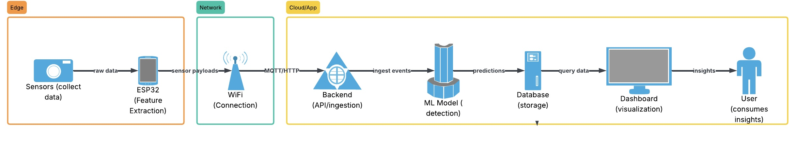
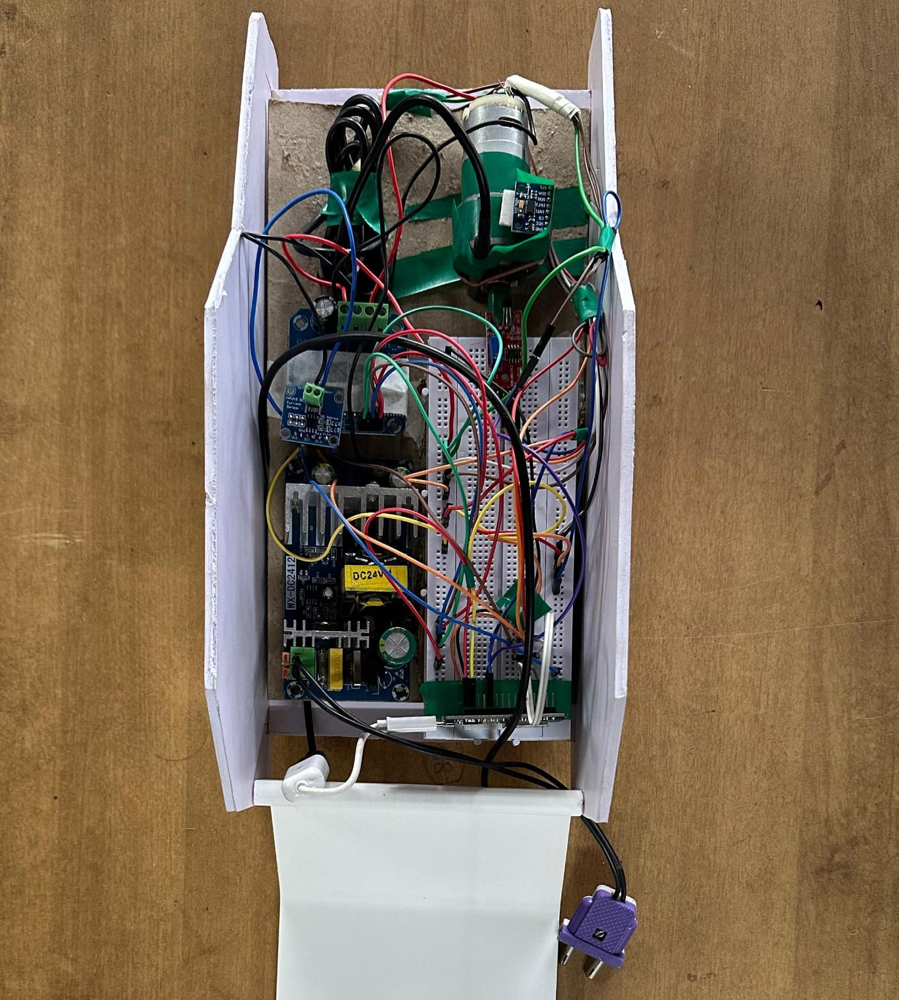
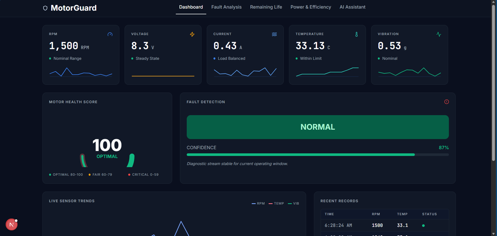
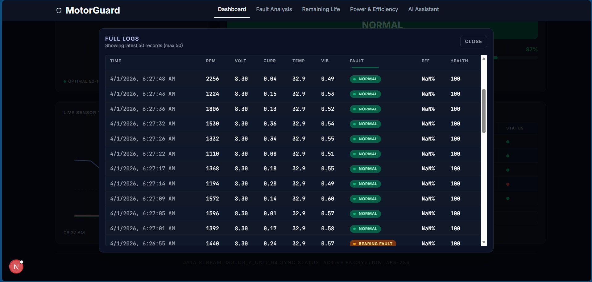
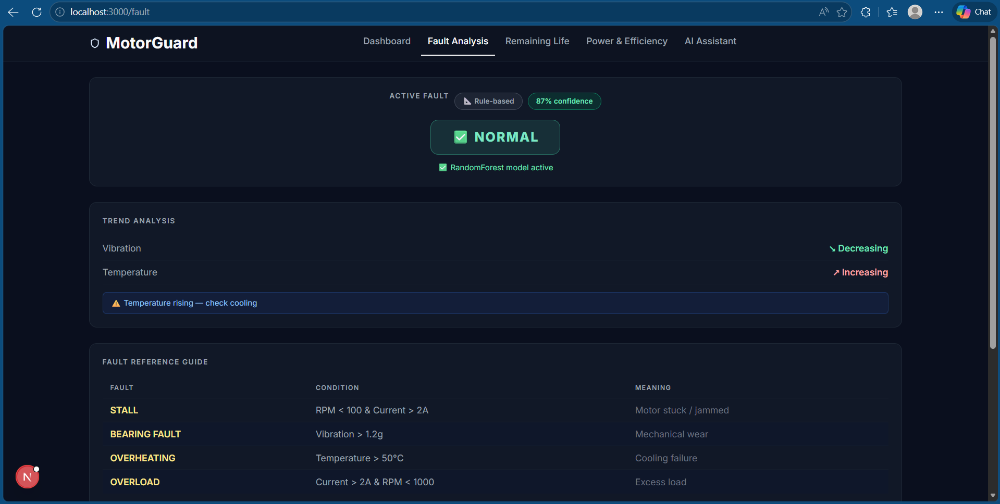

# MotorGuard: IoT + AI Predictive Maintenance for Electric Motors

MotorGuard is an end-to-end predictive maintenance platform that combines embedded sensing, real-time data streaming, cloud analytics, machine learning fault classification, and a modern web dashboard.

The system continuously monitors electric motor behavior using an ESP32 + sensors, sends telemetry to a FastAPI backend, and predicts likely faults using a trained Random Forest model. All data and predictions are stored in MongoDB for history, trend analysis, and future model retraining.

## Project Highlights

- Real-time motor telemetry ingestion from ESP32 (JSON over Wi-Fi)
- Fault prediction with ML-first strategy and rule-based fallback
- Confidence-aware fault reporting and motor health scoring
- RUL (Remaining Useful Life) approximation for temperature and vibration
- MongoDB-backed historical storage for analytics and retraining
- Next.js dashboard for live monitoring, trends, and diagnostic views
- AI assistant endpoint for contextual QA on recent motor records (Groq + RAG)

## Tech Stack

- Embedded: ESP32 (Arduino-style C), ADXL345, INA219, DS18B20, Hall sensor
- Backend: FastAPI, Pydantic, PyMongo, scikit-learn, joblib
- ML: Random Forest classifier (fault classes)
- Database: MongoDB Atlas
- Frontend: Next.js, React, Tailwind CSS

## Fault Classes

- NORMAL
- OVERHEATING
- OVERLOAD
- BEARING_FAULT
- STALL

## System Architecture

```text
Sensors -> ESP32 -> Wi-Fi JSON -> FastAPI Backend -> ML Inference + Analytics -> MongoDB
																													|
																													-> Next.js Dashboard (live + historical)
```

## Repository Structure

```text
realtime_miniproj/
|- backend/        # FastAPI API, analytics, ML model runtime, routes
|- esp/            # ESP32 firmware for sensor read + HTTP upload
|- frontend/       # Next.js dashboard (MotorGuard UI)
|- ml/             # Dataset generation + model notebook/artifacts
|- docs/images/    # Drop project screenshots and diagrams here
`- READme.md
```

## Image Placeholders (Upload Here)

The folders are already prepared for you:

- docs/images/
- docs/images/dashboard/

### 1) Architecture Diagram

Replace the placeholder file path below with your final diagram image:



### 2) Working Photo

Add your hardware setup / live working photo:



### 3) Dashboard Screenshots (3 Photos)

Add three dashboard screenshots in docs/images/dashboard/:





## Data Flow

1. Sensors collect rpm, voltage, current, temperature, and vibration.
2. ESP32 computes and packages data into JSON.
3. ESP32 sends telemetry to backend endpoint: /data.
4. Backend normalizes vibration, runs ML prediction, and applies confidence gate.
5. If ML confidence is low, backend falls back to rule-based classification.
6. Backend computes analytics (power, efficiency, health score, trend, RUL).
7. Enriched data is stored in MongoDB.
8. Frontend polls backend for live visualization and status updates.

## Backend API (Key Endpoints)

- POST /data: ingest one sensor reading and return computed diagnostics
- GET /data: latest stored records (recent 50)
- GET /analytics: trend summary, health average, fault distribution
- GET /predict/latest: prediction for newest record
- GET /predict/recent?limit=20: predictions for latest N records
- POST /model/reload: reload model from model.pkl without server restart
- POST /model/retrain-from-db?min_records=300: retrain RF model from labeled DB data
- GET /model-status: ML runtime status + confidence threshold
- GET /ai/context: preview retrieval context for AI assistant
- POST /ai/chat: RAG-style assistant over backend records (requires GROQ_API_KEY)

## Quick Start

### 1) Backend Setup (FastAPI)

```bash
cd backend
python -m venv .venv
# Windows
.venv\Scripts\activate
# Linux/macOS
# source .venv/bin/activate

pip install fastapi uvicorn pymongo pydantic scikit-learn joblib pandas
uvicorn main:app --reload --host 0.0.0.0 --port 8000
```

Backend runs at: http://localhost:8000

### 2) Frontend Setup (Next.js)

```bash
cd frontend
npm install
npm run dev
```

Frontend runs at: http://localhost:3000

### 3) ESP32 Setup

Update these values in esp/esp32.c:

- ssid
- password
- serverUrl (set to your backend reachable IP, e.g., http://<YOUR_IP>:8000/data)

Flash to ESP32 and open serial monitor to verify data upload response.

## ML Model Notes

- Model runtime is managed in backend/ml_predictor.py
- Expected input feature order:
	- rpm
	- current
	- temperature
	- vibration
- The backend uses an ML confidence gate (default 75%).
- If ML confidence is below threshold, rule-based logic is used.

## Environment Variables

Create backend/.env for optional AI assistant:

```env
GROQ_API_KEY=your_groq_api_key_here
```

MongoDB URI is currently configured directly in backend/config.py. For production, move it to environment variables.

## Example JSON Payload (ESP32 -> Backend)

```json
{
	"rpm": 1480,
	"voltage": 8.3,
	"current": 1.12,
	"temperature": 34.5,
	"vibration": 0.26
}
```

## Use Cases

- EV motor condition monitoring
- Industrial motor preventive maintenance
- Fault trend monitoring and diagnostics
- Data-driven maintenance scheduling

## Future Improvements

- Dockerized backend + frontend deployment
- Authentication and role-based dashboard access
- MQTT streaming pipeline support
- Automatic periodic retraining pipeline
- Alerts (SMS/Email/Webhook) for critical fault events

## License

Add your preferred license here (MIT/Apache-2.0/etc.).

